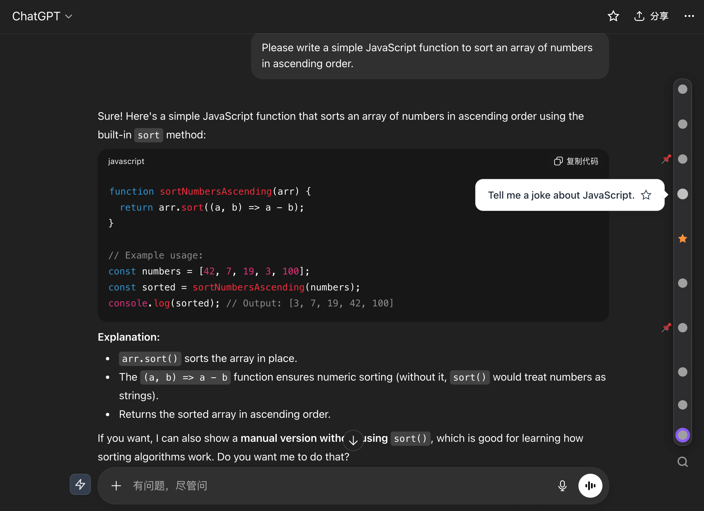

# ChatGPT Timeline Fixed

这是基于 [houyanchao/chatgpt-gemini-timeline](https://github.com/houyanchao/chatgpt-gemini-timeline) 的个人维护版本，重点适配新版 ChatGPT 的虚拟化对话页面。保留原 Timeline 的右侧时间轴、提问预览、收藏与固定节点，以及原项目的其他平台功能。原版项目说明见 [README.upstream.md](README.upstream.md)。



## ChatGPT 兼容性改进

- 从完整会话 API 或游标分页构建当前分支的有序用户提问索引；当前挂载的 DOM 窗口只用于匹配和定位。
- 识别 `data-turn-key` 等新版轮次结构，保留未挂载历史提问的圆点和预览。
- 优先按消息 ID 定位已挂载提问；未挂载时尝试虚拟列表定位，并在目标挂载后验证身份。
- 减少虚拟化跳转期间的重复索引请求与上下交替滚动，对 ChatGPT 使用即时最终对齐。
- 发送新提问时尝试即时追加节点，随后用完整 API 快照合并并去重。

## 主要功能

- 在对话页面右侧显示时间轴，并提供问题预览、节点收藏和固定。
- 支持文件夹、提示词库、快捷追问、公式复制、文本高亮和聊天导出等原项目功能。
- 保留 Gemini、DeepSeek、Claude、Kimi 等原项目支持的平台；本维护版没有移除 Gemini 功能。
- 重点维护新版 ChatGPT 的长对话索引、虚拟化列表识别和节点跳转。

除 ChatGPT 时间轴兼容性外，其他平台与功能不是此维护版当前的改进重点。

## 本地安装

1. 下载或克隆本仓库，保留目录中的 `manifest.json`、`js/`、`styles/` 等文件。
2. Edge 打开 `edge://extensions/`，或 Chrome 打开 `chrome://extensions/`。
3. 开启“开发者模式”，选择“加载解压缩的扩展程序”，选中本仓库根目录。
4. 已打开的 ChatGPT 标签页需要刷新一次，以便 `document_start` 脚本注入。之后更新本地代码时，先在扩展管理页重新加载扩展，再刷新标签页。

无需卸载原扩展或清空存储；若同时启用两个版本，建议暂时只启用一个以免出现两个时间轴。

## 开发与检查

安装 Node.js 后，可在仓库根目录运行：

```bash
npm install
npm test
npm run build:chrome
npm run build:firefox
```

构建产物位于忽略提交的 `web/` 目录，不应把本地构建包、浏览器配置或调试日志提交到仓库。

## 状态与限制

Node 回归测试覆盖分页索引、局部响应防覆盖、虚拟 DOM、增量提问和导航竞态。新版 ChatGPT 的 DOM 与内部虚拟列表可能继续变化。最近一次真实 Edge 诊断确认时间轴与预览可显示，但部分历史跳转存在反复滑动；本次导航改动尚未在用户的已登录 Edge 页面完成复测，因此不宣称所有长对话跳转已稳定。浏览器登录状态、网络权限和不同分支也需要自行验证。

## 来源与许可

原项目完整名称为 **chatgpt-gemini-timeline**，作者 [houyanchao](https://github.com/houyanchao)，原项目地址为 [houyanchao/chatgpt-gemini-timeline](https://github.com/houyanchao/chatgpt-gemini-timeline)。感谢原作者及其项目所继承的 Reborn14 工作。

本维护版参考了 [bujue3709/GPT-Conversation-Toolkit](https://github.com/bujue3709/GPT-Conversation-Toolkit) 对完整会话索引和虚拟化导航的处理思路。该项目是技术参考来源；本仓库没有复制其界面或整套文件。

本仓库保留原项目的 [GPL-3.0 许可证及版权声明](LICENSE)，并在 [NOTICE.md](NOTICE.md) 汇总来源和第三方许可信息。Toolkit 仓库采用 MIT 许可；若后续直接复制其代码，应在相应文件保留版权与许可声明，并同步更新 `NOTICE.md`。
